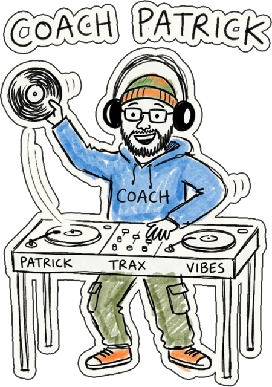

<p align="center">
  
</p>

<h1 align="center">DJ Patrick School</h1>

<p align="center"><strong>Learn to mix like a DJ, right in your browser.</strong></p>

<p align="center"><a href="https://tpwl21.github.io/djpatrickschool/"><strong>Play now →</strong></a></p>

---

## What is it?

A DJ school shaped like a game. Patrick, your coach, explains each move in a short lesson, then you practice **on real music**. The game checks what you actually do: the tempo, when you drop the track, your settings.

Free, no account, nothing to install.

## The workshops

| Workshop | You learn to… |
|---|---|
| **Beatmatching** | lock two tracks together so they sound like one |
| **EQ & Faders** | move from one track to the next cleanly (crossfader, bass, volume) |
| **Harmonies** | pick tracks that sound good together (keys, Camelot wheel) |
| **FX** | color your transitions (filter, echo, reverb, loop roll) |
| **Digging** | find the right track at the right moment |
| **Reading the Crowd** | feel the dancefloor's energy and adapt your mix |

And for the curious, a **Secret Booth** to mix freely… if you find the code.

## Three difficulty levels

- **Easy**: lots of visual help to understand what's going on.
- **Medium**: less help, you start listening.
- **Pro**: by ear only, like in a club.

The harder it gets, the darker the club.

## What do I need?

- A computer, tablet or phone (the Secret Booth needs a tablet or computer screen).
- **Headphones or the sound turned up**: everything is played by ear.
- Got a USB DJ controller (for example a Pioneer DDJ-SR)? Plug it in, it works too.

The site is available in English and French. Your progress is saved in your browser.

## License

Created by **DJ Patrick**. Open source and free for classes, workshops and events.

- **Code**: [AGPL-3.0](LICENSE). Modified versions you publish stay open source and keep the credits.
- **Lessons, levels, Patrick and the artwork**: [CC BY-NC-SA 4.0](LICENSE-CONTENT.txt). Credit required; **commercial use needs permission**.
- The DJ Patrick School name and the Patrick character are not licensed as a brand.

Details in [NOTICE.md](NOTICE.md). Using it in a class or an event? I'd love to hear about it.

---

<details>
<summary><strong>For developers</strong></summary>

React + Vite site, deployed automatically to GitHub Pages on every update to `main`.

```bash
npm install
npm run dev      # http://localhost:5173/djpatrickschool/
npm run build    # production build in dist/
```

- Workshops, levels and lessons are described in TOML files under `src/workshops/`.
- Interface text lives in `src/locales/` (English and French).
- The art direction is described in `DESIGN.md`, the product in `PRODUCT.md`, and the action plan in `TODO.md`.

</details>
